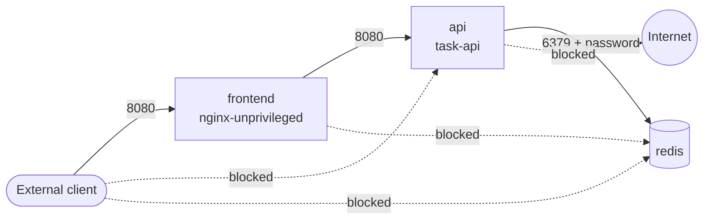

# Hardened Kubernetes Platform


A defense-in-depth Kubernetes platform for a 3-tier application, with every security control **verified by automated attack tests on a real cluster** in CI.

- **Terraform** for a hardened AWS EKS environment (validated and scanned in CI; not applied, to avoid cloud cost)
- **Kubernetes manifests** enforcing the `restricted` Pod Security Standard, least-privilege RBAC and zero-trust NetworkPolicies
- **Falco** runtime detection with custom rules mapped to MITRE ATT&CK
- **kube-bench** CIS benchmark report on every run
- **End-to-end tests** that try to break each control and fail the pipeline if any attempt succeeds

The application tier is the API from [secure-cicd-pipeline](https://github.com/jaymeeljr/secure-cicd-pipeline); CI builds it from that repository and deploys it here.

## Architecture



Solid arrows are the only paths NetworkPolicy allows. Every dashed path is tested in CI and must be blocked.

## Security controls and how each one is proven

| Layer | Control | Proven by |
| --- | --- | --- |
| Admission | Namespace enforces `restricted` Pod Security Standard | `tests/test-pod-security.sh`: privileged, root and hostPath pods are rejected by the API server |
| Workload | Non-root high UIDs, read-only root FS, all capabilities dropped, `RuntimeDefault` seccomp, no service-account token | Checkov + OPA policies in CI; admission accepts the pods |
| Identity | Separate ServiceAccounts; read-only `developer` role; `ci-deployer` role that can roll out but not read Secrets or exec | `tests/test-rbac.sh`: impersonates each role with `kubectl auth can-i` |
| Network | Default-deny ingress and egress; only frontend → api → redis allowed; DNS only outbound | `tests/test-network-policy.sh`: 11-case connectivity matrix from probe pods |
| Secrets | Redis config generated at deploy time, mounted as a file (mode 0440), never committed or put in env vars | Redis answers `NOAUTH` to unauthenticated clients |
| Resources | ResourceQuota + LimitRange; no LoadBalancer or NodePort services | Quota is enforced on every pod in the namespace |
| Runtime | Falco with custom rules: shell in workload, package manager use, outbound connection from data tier | `tests/test-falco.sh`: opens a shell in the API pod and asserts the alert fires |
| Node | CIS Kubernetes Benchmark | kube-bench report uploaded as a CI artifact |

## Policy-as-Code

OPA rules in [`policy/`](policy/) block insecure manifests before they reach a cluster. The policies have their own unit tests.

**Bug the tests caught:** the first version of the `allowPrivilegeEscalation`, `automountServiceAccountToken` and seccomp rules compared fields with `!=`. In Rego, a comparison on a missing field is *undefined*, so a manifest that left the field out passed silently. A regression test that removes the field exposed it, and the rules were rewritten as `not field == expected`. The same fix was applied upstream in `secure-cicd-pipeline`.

## AWS EKS (Terraform)

[`terraform/aws-eks`](terraform/aws-eks) describes the production target:

- Nodes in **private subnets** only; VPC flow logs; default security group locked down
- API endpoint **private**, public access restricted to listed CIDRs (a validation rule rejects `0.0.0.0/0`)
- Kubernetes Secrets **envelope-encrypted** with a customer-managed KMS key (rotation on)
- All five **control-plane log types** to CloudWatch, KMS-encrypted, retained 365 days
- **IMDSv2 required** with hop limit 1, so pods cannot steal node IAM credentials; encrypted EBS
- **IRSA** for per-pod AWS permissions; access entries instead of the legacy `aws-auth` ConfigMap
- VPC CNI with **native NetworkPolicy** enforcement, so `k8s/` policies apply unchanged on EKS
- **GuardDuty** EKS audit-log analysis and runtime monitoring
- Modules **pinned to commit SHAs**, not tags, so a moved or compromised tag cannot change the infrastructure

```bash
cd terraform/aws-eks
cp terraform.tfvars.example terraform.tfvars   # set admin_cidrs
terraform init -backend-config="bucket=<state-bucket>" -backend-config="key=eks.tfstate" -backend-config="region=eu-central-1"
terraform plan
```

## Run it locally

Requires Docker, kind, kubectl and Helm, with `secure-cicd-pipeline` cloned next to this repo.

```bash
./scripts/up.sh          # cluster + Calico + app + Falco + all tests
kind delete cluster --name hardened
```

## Known trade-offs

- Third-party images are pinned by tag, not digest; Renovate-managed digest pinning is the next step.
- Falco and kube-bench need host-level access, so they run in their own namespaces outside the restricted policy.
- kind is a development cluster: some kube-bench control-plane checks fail by design. On EKS, AWS manages the control plane.

## Author

Jamil Qarahmadov — DevSecOps Engineer · cemil.qarahmedov@gmail.com
